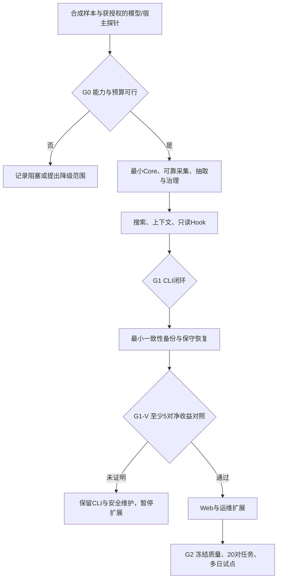

# 项目记忆助手：R2 方案修订记录

日期：2026-10-18。方法：ECC Blueprint 的分阶段规划与独立反向审查。状态：**文档修订草案，未开发、未运行探针、未验收**。本记录不授权读取真实会话、外发内容、配置模型或安装 Hook。

## 文档职责

| 文档 | 负责回答 |
|---|---|
| [落地执行方案](./MemHub-落地执行方案.md) | 产品行为、技术边界、取舍和阶段决策 |
| [验收标准](./MemHub-验收标准.md) | 操作、预期状态、证据与通过标准 |
| [实施计划](./docs/superpowers/plans/2026-10-18-project-memory-v1.md) | 文件、接口、依赖、测试和提交单元 |
| [调研报告](./MemHub-调研报告.md) | 历史研究背景；其中早期草案不覆盖 R2 决策 |

保留调研报告原样，避免把后续设计决定伪装成当时的研究结论。对产品语义的修订须同步方案、验收、实施计划；不另建第二份“最新方案”。

## 变更决策与代价

| 决策 | 旧行为/问题 | R2 决定 | 代价和验证 |
|---|---|---|---|
| D01 审批边界 | 用 TTY/验证码宣称 Agent 无法批准，忽略 Agent 可控制 PTY | 内置模型管线无批准能力；无效确认拒绝；有效交互记 operator_attested，不宣称独立真人证明 | 强真人隔离需求不受支持，不能以当前 v1 上线满足该需求；AC-41a 包含实际 PTY 能力测试 |
| D02 冲突权限 | 模型 conflict 就停用用户已批准规则 | suspected 只提示；交互确认 confirmed_unresolved 才暂停；证据失效/撤权仍立即停用 | 新改口未审阅前旧规则可能继续提示；明确当前指令优先、可撤回；AC-24、41b、48 |
| D03 范围语义 | 空数组等于全项目，未知范围可能被扩大 | project/paths/unknown 判别联合；unknown 不可批准；人工澄清留独立记录；启动仅全项目 | 首版局部规则需显式 CLI 查询，不承诺按当前文件自动召回；AC-49 |
| D04 规模与费用 | 全量 Stage B 可随着旧记忆增长，200批/日不能约束请求数 | maxAutoReviewMemories 初始50；超过则整批暂停自动抽取；冻结日/批请求、token、等待预算 | 不保证自动审查无限增长；50/200/1000规模探针记录真实成本；AC-50 |
| D05 保守恢复 | 独立日志链、outbox回放、尾部完整性证明过于复杂 | 恢复active→needs_review、pending→stale、未完成jobs取消；新runtimeEpoch；关闭注入并重新审阅 | 恢复后有人工工作；首版不做审计日志自动回放；AC-44 |
| D06 单项目存储 | 清空A要改写含B的共享快照，易破坏恢复链 | 一个dataDir一个项目；备份仅该目录受管backups；不接受共享/跨项目快照 | 多项目用独立目录，首轮仍只试点一个；归属异常阻塞清空，不越界删；AC-02、46 |
| D07 顺序修复 | G0前存储测试依赖G0后Core | G0只做T01–T02探针；允许临时DB直连；通过后生产schema与最小writer/test Core一起实施 | G0不证明产品完整性；生产写入仍唯一Core；原依赖环解除 |
| D08 提前验证价值 | Web/复杂运维之后才第一次验证净收益 | CLI闭环后、Web前做5对真实任务；真实数据前具备最小安全备份恢复 | 5对只是投资判断；未过暂停扩展，最终20对与多日试点不减少；AC-51 |
| D09 分离版本 | 一次普通审批改变全项目generation，迫使旧批次重做 | authorizationEpoch、runtimeEpoch、memoryGeneration、governanceVersion各司其职 | B仍需检查整个有效集合，变更只重做B且扣预算；AC-26、52 |
| D10 删除旧表述 | “全离线”“本地模型”与远程API路线冲突 | 本地操作可离线，远程抽取只访问确认端点，断网blocked | 仍有第三方数据外发；不静默切换模型；AC-38–39 |

## 保留的技术选择

- TypeScript + Node.js 24 LTS：CLI、文件采集与本机页面共用语言；精确版本和原生依赖兼容性在 G0 验证。
- SQLite WAL + 单写者 Core：业务数据一个权威源，审阅、版本和索引同事务；不增加可写 Markdown 副本。
- 文件监听 + 补扫：继续保留字节游标、处理账本、文件代次与指纹，不把通知成功当作不丢数据的证据。
- 两阶段抽取：A提出、B核对证据和旧规则；B仍可能与A犯相同错误，语义正确率以人工评测为准。
- FTS5 + 短词回退：先满足精确/子串检索，不先建设向量库；语义检索失败样例积累后再决策。
- 只读启动 Hook：不启动抽取，不依赖 Core 在线，超时降级；宿主生命周期和真实截止必须另测。

没有在本次修订中选择免费平台、购买额度、安装依赖或改宿主设置。旧版25–30人日估算需在G0后按实际规模和失败项重估。

## 阶段及决策

G1-V 判据：助手遵守至少4/5且不低于基线，中位实际总耗时低于基线，否决事件0；包括审阅、纠错、重复说明、维护和关键路径等待，重叠活动不重复计时。任务、标签与判据提前固定，早期样本不进入最终冻结集。

## 执行前仍须取得的输入

| 输入 | 缺失时如何处理 |
|---|---|
| 明确的免费API平台/模型与数据政策同意 | 模拟/合成测试可推进，真实外发和质量门槛BLOCKED |
| 目标Mac、Claude Code版本、可复现实机探针 | 不宣称宿主兼容、性能和生命周期通过 |
| 真实会话样本和试点项目的明确授权 | 不扫描真实历史；只用合成fixtures |
| 人工标签与真实审阅时间 | 不由抽取模型自评全部正确，不填写虚构收益 |
| 是否必须具备独立真人认证 | 若要求，则当前审批方案不满足；先设计受保护通道再接入，不伪造安全保证 |

普通研发可以从合成样本与无外发的探针开始；上表各项在依赖它的动作前取得，不能把“同意方案”当作一揽子授权。

## 变更与验证记录

- R1：原20任务实施计划，包含初始任务/验收映射；后经会话设计审查发现审批、冲突、范围、规模、恢复和收益时序问题。
- R2：采用上述D01–D10，修改现有方案/验收/实施计划，新增本决策记录；旧研究报告未修改。
- 文档验证：需检查本地链接、任务依赖、公共接口、AC-01–52（含41a/b）映射、旧承诺残留，以及跨文档决策一致性。
- 工程与产品验证：**全部 NOT_RUN**。文档检查与独立设计审查不能替代代码测试、真实API质量或多日试点。

后续变更记录必须说明原因、受影响任务/AC、取舍、验证和回退方式。禁止在看到实际测试结果后把失败项改成“不适用”来完成签收。
